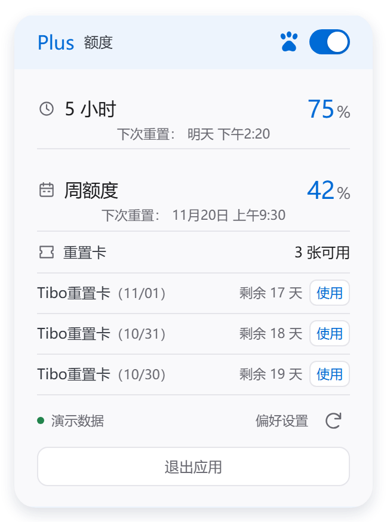
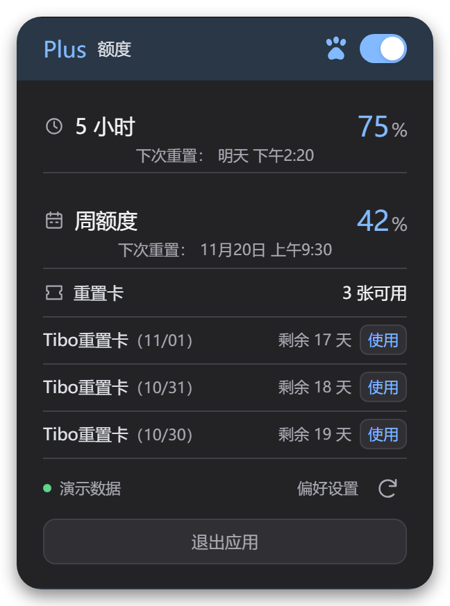
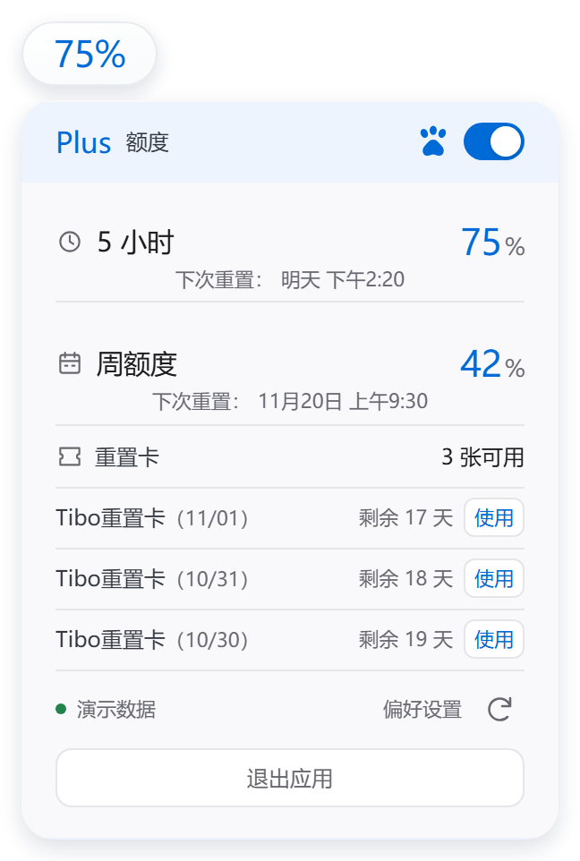
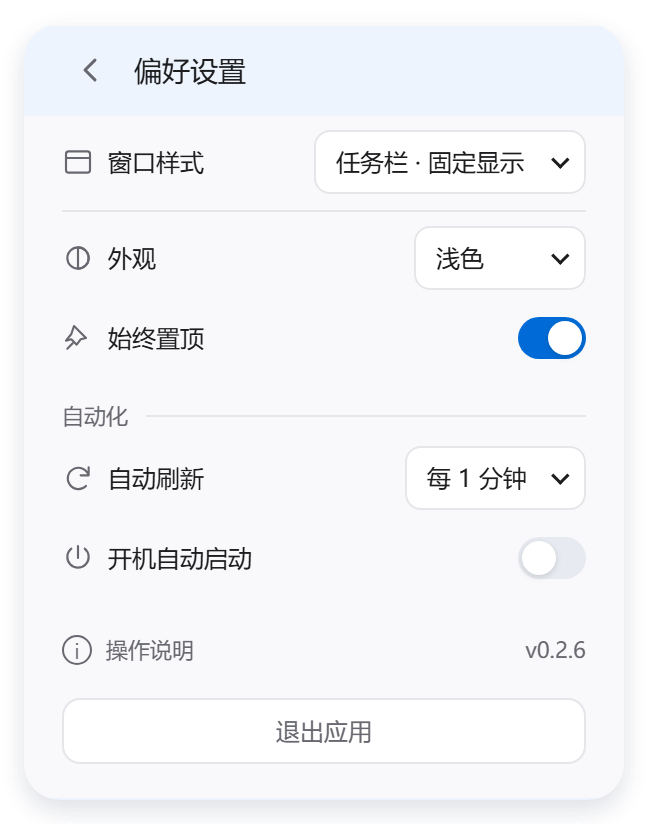
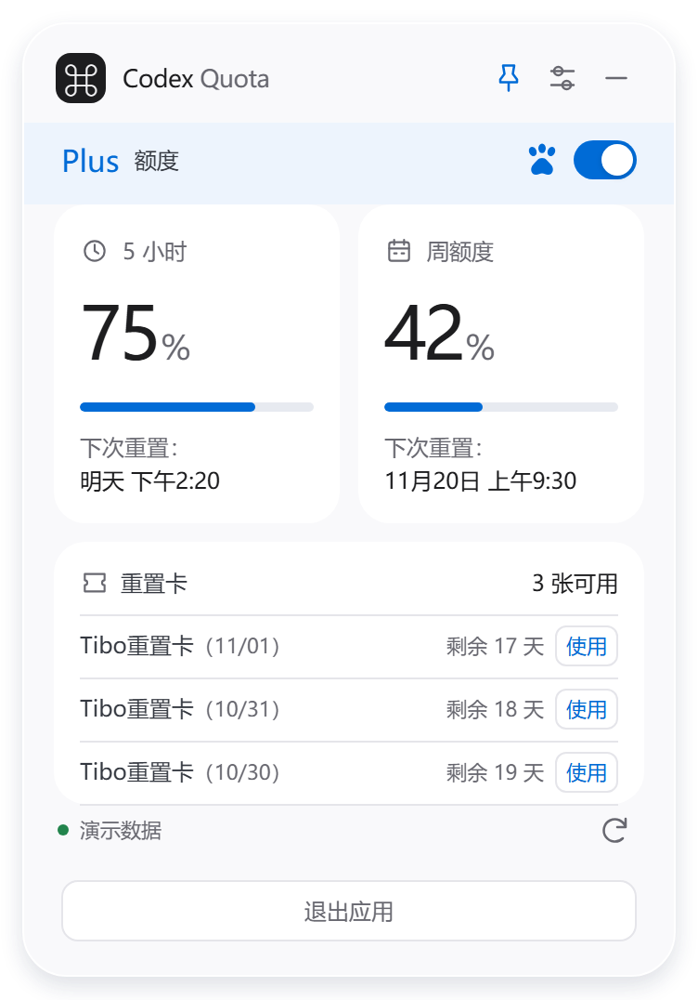
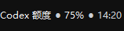

# Codex 额度监控

不用反复打开额度页，在桌面或任务栏就能查看 Codex 的 5 小时与周额度、下次重置时间，以及重置卡的剩余有效时间。

版本 `0.2.6` · Windows x64 · 公开测试版（Pre-release） · 第三方桌面工具

[下载 Windows x64 安装版](https://github.com/Xucool/codex-quota-float-custom/releases/download/v0.2.6/CodexQuotaFloatCustom-0.2.6-Windows-x64-Setup.exe) · [下载便携版](https://github.com/Xucool/codex-quota-float-custom/releases/download/v0.2.6/CodexQuotaFloatCustom-0.2.6-Windows-x64-Portable.zip) · [SHA-256 校验文件](https://github.com/Xucool/codex-quota-float-custom/releases/download/v0.2.6/SHA256SUMS.txt)

> 这是公开测试版，已知验证范围见下文。以下界面预览均使用演示数据。

## 功能亮点

- 三种显示方式：简约卡片、百分比悬停、任务栏固定显示，可按使用习惯切换。
- 两类额度分开显示：5 小时与周额度各有剩余百分比和本地时间的重置时刻，不混淆数据。
- 重置卡列表：查看可用数量和剩余有效时间，最多显示三行，更多卡片滚动查看；可向本机 Codex 发起使用请求。
- 宠物显示开关：爪印与开关状态同步，点击先反馈，后台再显示或隐藏 Codex 宠物。
- 本机偏好：深浅色跟随系统，支持自动刷新、置顶和自选开机启动；下次启动恢复上次模式。

## 界面预览

<table>
  <tr>
    <td align="center">额度总览 · 浅色</td>
    <td align="center">额度总览 · 深色</td>
  </tr>
  <tr>
    <td></td>
    <td></td>
  </tr>
  <tr>
    <td align="center">百分比悬停</td>
    <td align="center">偏好设置</td>
  </tr>
  <tr>
    <td></td>
    <td></td>
  </tr>
  <tr>
    <td align="center">简约卡片</td>
    <td align="center">任务栏文字预览</td>
  </tr>
  <tr>
    <td></td>
    <td align="center"></td>
  </tr>
</table>

前五张为真实界面渲染，使用演示数据。任务栏小条为任务栏文字渲染预览，演示数据，不是整条任务栏截图。图中的额度、日期和卡片不代表任何真实账户。

## 安装与开始使用

从本页顶部或 [本版本发行页](https://github.com/Xucool/codex-quota-float-custom/releases/tag/v0.2.6) 选择一种下载：

- 安装版：`CodexQuotaFloatCustom-0.2.6-Windows-x64-Setup.exe`
- 便携版：`CodexQuotaFloatCustom-0.2.6-Windows-x64-Portable.zip`

不要把 GitHub 自动生成的源码压缩包当成安装包。

1. 安装官方 Codex，并使用自己的 ChatGPT 账户登录。
2. 运行下载的 Setup 安装程序，为当前 Windows 用户安装，无需管理员权限。
3. 从桌面的“Codex 额度监控”快捷方式打开，等待连接后查看额度。
4. 在“偏好设置 → 窗口样式”选择显示模式。开机启动默认关闭，需要时自行开启。

安装完成不会自动运行软件。普通使用者不需要安装 Node.js 或开发工具。卸载前先退出软件，再通过 Windows 的“应用和功能”卸载。

选择便携版时，先完整解压，再打开目录中的 `CodexQuotaFloatCustom.exe`；不能只复制主程序。

本版尚未做代码签名，Windows 可能提示未知发布者。请确认来源可信后再运行，不需要关闭系统安全功能。

## 三种显示模式

| 模式 | 适合怎样使用 | 主要操作 |
| --- | --- | --- |
| 简约卡片 | 直接查看完整额度与重置卡 | 点击偏好设置进入第二页 |
| 百分比悬停 | 桌面只留一个紧凑百分比 | 鼠标移入查看详情；拖入任务栏切换模式 |
| 任务栏固定显示 | 长期查看 5 小时额度和重置时刻 | 悬停看详情；左键选择返回悬浮窗；右键选择退出应用 |

任务栏文字固定在隐藏图标箭头左侧，示例为 `Codex 额度 ● 39% ● 16:20`。百分比与时间分别对应 5 小时剩余额度及其重置时刻。移出文字和选项弹窗后，选项会收起。

更完整的操作方法见 [使用说明](docs/使用说明.md)。

## 兼容性与使用条件

- Windows 10 x64：已在开发机验证。
- Windows 11、ARM 及其他任务栏环境：尚未验证，不承诺任务栏模式兼容。
- 系统需有 .NET Framework 4.6.1 或更高版本；Windows 10 通常已包含更高版本。
- 需要安装官方 Codex 并登录自己的 ChatGPT 账户。仅 API Key 登录可能没有可显示的套餐额度。
- 宠物功能依赖 Codex 已配置宠物及相应快捷键，不是本软件内置宠物。

当前仅完成安装包编译，尚未执行该安装包的安装实测，也未在第二台电脑完成验证；开发机应用运行正常不等于所有电脑或安装流程都已验证。

## 隐私与重置卡提示

软件通过本机官方 Codex CLI 访问当前用户的登录状态和额度，不要求在本软件中输入密码或手动复制 Token。Codex 获取真实数据仍需联网。本改版没有额外的同步服务器或账户系统，偏好和窗口位置保存在本机。

“使用重置卡”会发出真实请求，可能消耗所选卡片；不是演示按钮。当前已验证接口与模拟交互，尚未真实消耗卡片实测。结果不确定时，请先刷新核对，不要连续重复使用。

发布包不得包含维护者或其他人的登录资料、个人配置、账户日志和真实账户截图。

## 常见问题

**为什么连接不上？**

先确认本机官方 Codex 已安装，并能用自己的 ChatGPT 账户正常登录。更新或重新登录 Codex 后，退出并重开额度监控。仍提示找不到 CLI 时，需要检查 Codex CLI 是否已安装并可用。

**为什么没有显示额度或重置卡？**

数据取决于 Codex 实际返回。仅 API Key 登录、接口未返回卡片明细或连接失败时，软件不能凭空补出数据；以界面提示为准。

**宠物开关为什么没反应？**

先在 Codex 中选择宠物。主动点击“显示”且找不到窗口时，软件会尝试 `Win+Alt+P`；没有配置宠物或快捷键不一致时可能无法显示。启动软件不会自动调用该快捷键。

**退出后会记住模式吗？**

会保留所选模式与偏好，下次启动恢复。安装本身不会默认开启开机启动。

## 版本与反馈

当前版本：`0.2.6`，说明日期：2026-11-13。变更与已知限制见 [发布说明](docs/发布说明.md)。

维护账号：[Xucool](https://github.com/Xucool) · [发布仓库](https://github.com/Xucool/codex-quota-float-custom) · [问题反馈（Issues）](https://github.com/Xucool/codex-quota-float-custom/issues)

反馈时提供 Windows 版本、软件版本、使用模式和错误提示即可；不要发送密码、Token、登录文件或真实账户截图。

## 致谢、授权与发布范围

本改版基于 [Leon-z7/codex-quota-float](https://github.com/Leon-z7/codex-quota-float)，应用内部名称为 `CodexQuotaFloatCustom`。感谢原作者的项目基础。本工具不是 OpenAI 官方产品。

维护者已确认获得原作者的修改与再分发授权。本仓库发布说明、截图及编译后的安装包与便携包，当前不公开改版源码；此授权说明不等于对全部源码授予新的许可，也不替代原项目及第三方依赖的许可条款。详见 [发布前检查](docs/发布前检查.md)。

## 维护者构建

以下用于维护者本地源码项目，公开仓库不包含对应的改版源码与构建脚本，普通使用者无需执行。需要 Windows x64、Node.js 22.12+，以及能够构建 .NET Framework 4.6.1 目标项目的 .NET SDK。

```powershell
cd desktop
npm ci
npm test
node ..\scripts\validate.mjs
npm run release:win
```

`package:win` 仅生成应用目录：`desktop/release/0.2.6/CodexQuotaFloatCustom-win32-x64`。目录包含 Electron 必需运行文件与现用 `TaskbarHost`，不能只复制主程序。

`release:win` 从干净目录独立生成安装版和便携版，无需先运行 `package:win`。需要固定版本的 Electron 本地缓存，以及 Inno Setup 编译器：

- Electron 缓存可通过 `ELECTRON_ZIP_DIR` 指定，也可使用脚本识别到的本机缓存；缺少缓存时停止，不反复下载。
- Inno Setup 可通过 `QUOTA_ISCC` 指定 `ISCC.exe`，默认位置为 `build-cache/release-tools/inno-7.1.1/ISCC.exe`。

最终产物位于 `desktop/release/publish/`：

- `CodexQuotaFloatCustom-0.2.6-Windows-x64-Setup.exe`
- `CodexQuotaFloatCustom-0.2.6-Windows-x64-Portable.zip`
- `SHA256SUMS.txt`：最终发布文件的校验值。
- `release-manifest.json`：本地打包清单。

安装包不应从个人正在使用的旧目录直接制作。`package:win` 另支持用 `QUOTA_BUILD_TMP` 指定暂存目录、`QUOTA_PACKAGE_OUT` 指定应用目录输出位置。

## 本次更新

- 更新偏好设置下拉菜单，调整重置时间居中、窗口样式行及重置卡弹窗布局。
- 偶发悬停无法展开仍需继续观察，尚不宣称彻底解决。
- 本次通过 69 项自动化测试；未执行安装包安装实测及真实重置卡消耗。
- 下方截图已按本版重新生成，均为演示数据；任务栏文字预览沿用上版。

## 简要历史

- `0.2.5-custom.3`：收敛为三种模式，加入任务栏固定显示、第二页偏好设置、宠物开关及重置卡交互。
- `0.2.4`：修复百分比悬停展开和收起时的过渡。
- `0.2.3`：加入百分比悬停模式。
- `0.2.0`：移除跨设备同步，改为 Windows 本机工具。

历史 Capsule、Fluent、Mini 布局已不在当前模式列表中；旧版截图不能代表当前版本。
