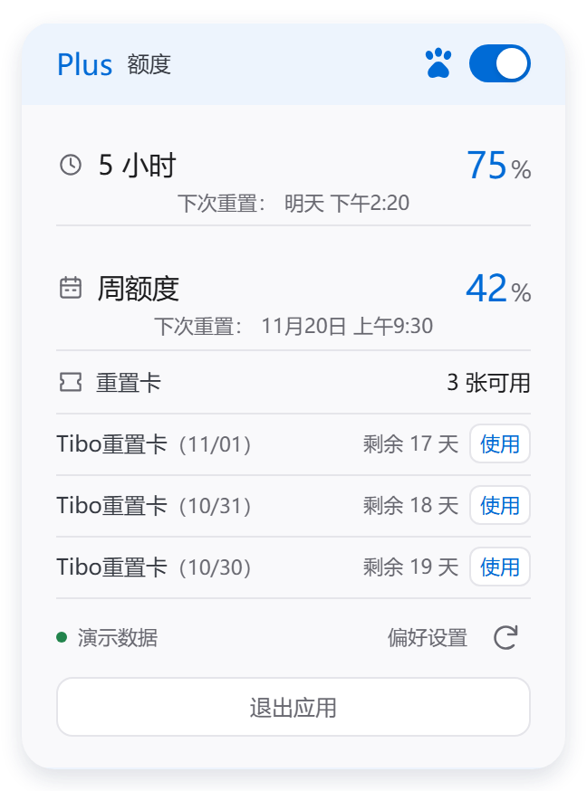

# 使用说明

Codex 额度监控（CodexQuotaFloatCustom） · `0.2.6`

当前为公开测试版（Pre-release）。说明日期：2026-11-13。

## 使用前

这是第三方额度工具，需要读取你自己电脑上 Codex 的登录状态。先安装官方 Codex，并使用自己的 ChatGPT 账户登录；本软件不会提供账号或共享其他人的额度。API Key 登录可能没有可显示的套餐额度。

当前已验证 Windows 10 x64 开发机环境。Windows 11、ARM 及其他任务栏环境尚未验证。系统需要 .NET Framework 4.6.1 或更高版本，Windows 10 通常已包含更高版本。无需安装 Node.js、.NET SDK 或其他开发工具。

## 安装、打开与卸载

1. 从 [本版本发行页](https://github.com/Xucool/codex-quota-float-custom/releases/tag/v0.2.6) 下载文件名以 `-Setup.exe` 结尾的安装版，确认来源可信后运行，按提示为当前用户安装，不需要管理员权限。
2. 安装完成后，使用桌面的“Codex 额度监控”快捷方式打开。安装程序不会自动运行软件，也不会默认开启开机启动。
3. 第一次打开时等待连接本机 Codex。需要开机启动时，在偏好设置中主动开启。
4. 卸载前先在软件中选择“退出应用”，再通过 Windows 的“应用和功能”卸载。

选择便携版时，下载以 `-Portable.zip` 结尾的文件，完整解压后运行 `CodexQuotaFloatCustom.exe`，不要只复制主程序。发行页另附 `SHA256SUMS.txt` 供核对下载文件。

本版未进行代码签名，Windows 可能显示未知发布者提示。请核对下载来源；不建议关闭杀毒软件或系统安全功能来运行。

## 三种模式

真实界面渲染，使用演示数据。图中的额度、日期与重置卡不代表真实账户。

在“偏好设置 → 窗口样式”切换：

- 简约卡片：直接显示额度详情。
- 百分比悬停：平时显示紧凑百分比，鼠标移入后显示详情。拖动悬浮窗进入任务栏，可切换为任务栏模式。
- 任务栏固定显示：文字显示在隐藏图标箭头左侧，如“Codex 额度 ● 39% ● 16:20”。百分比为 5 小时剩余额度，时间为其重置时刻；鼠标悬停显示完整详情。

任务栏模式左键显示“返回 Percent 悬浮窗”的选项，选择后回到百分比悬停；右键显示退出应用的选项，选择后退出整个软件。移出文字和选项弹窗后，选项会收起。

软件保留退出时的模式和偏好，下次打开时恢复。任务栏模式依赖系统任务栏结构，未验证的 Windows 环境中可能无法使用。

## 额度与重置卡

额度详情显示 5 小时、周额度及各自重置时刻。时间使用当前电脑的本地时区。手动刷新和自动刷新都读取 Codex 实际返回的数据，不会增加额度。

重置卡区域显示可用数量和剩余有效时间，最多同时显示三行；有更多卡片时，在列表上滚动查看。没有返回卡片明细不等于一定没有卡，以界面提示和 Codex 的实际结果为准。

“使用”会发送真实的额度重置请求，可能消耗所选卡片。请确认卡片和当前额度确实需要重置后再操作。若提示结果不确定，先刷新检查，不要连续重复点击。本版尚未进行真实消耗卡片的实测。

## 宠物开关

额度页右上角的爪印和开关用于显示或隐藏 Codex 的桌面宠物：蓝色表示显示，灰色表示隐藏。点击后开关先反馈，后台再完成操作；失败时会恢复真实状态并提示。

本软件不内置宠物。需要先在 Codex 中选择和启用宠物。当你主动点击“显示”且未找到宠物窗口时，软件会尝试调用 `Win+Alt+P`；快捷键不同或没有配置宠物时可能无法显示。启动软件不会自动调用这个快捷键。

## 偏好设置

点击额度页中的“偏好设置”进入第二页。可设置窗口样式、跟随系统或深浅色、自动刷新间隔、始终置顶和开机自动启动。底部保留退出应用按钮。

## 连接不上时

- 确认官方 Codex 已安装，并能使用自己的 ChatGPT 账户正常登录。
- Codex 更新或重新登录后，退出并重新打开额度监控；也可以先点击刷新。
- 仍提示找不到 CLI 时，需要检查 Codex CLI 是否已安装并可用。向维护者反馈错误提示和 Windows 版本即可，不要发送密码、Token、登录文件或完整账户日志。
- 数据未返回或已过期时，以界面的连接状态为准，不把旧数据当成最新余额。

## 来源与发布状态

原项目：[Leon-z7/codex-quota-float](https://github.com/Leon-z7/codex-quota-float)。改版维护账号：[Xucool](https://github.com/Xucool)。

公开测试版发布于 [Xucool/codex-quota-float-custom](https://github.com/Xucool/codex-quota-float-custom)，问题可提交至 [Issues](https://github.com/Xucool/codex-quota-float-custom/issues)。本仓库提供说明、截图和编译后的程序，当前不公开改版源码。

维护者已确认获得原作者的修改与再分发授权；本说明不新增或替代原项目及第三方依赖许可。本软件不是 OpenAI 官方产品。
